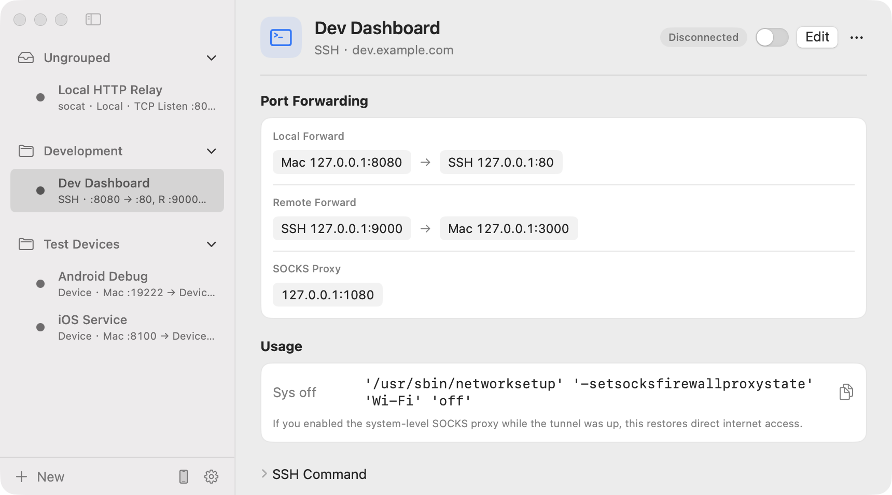
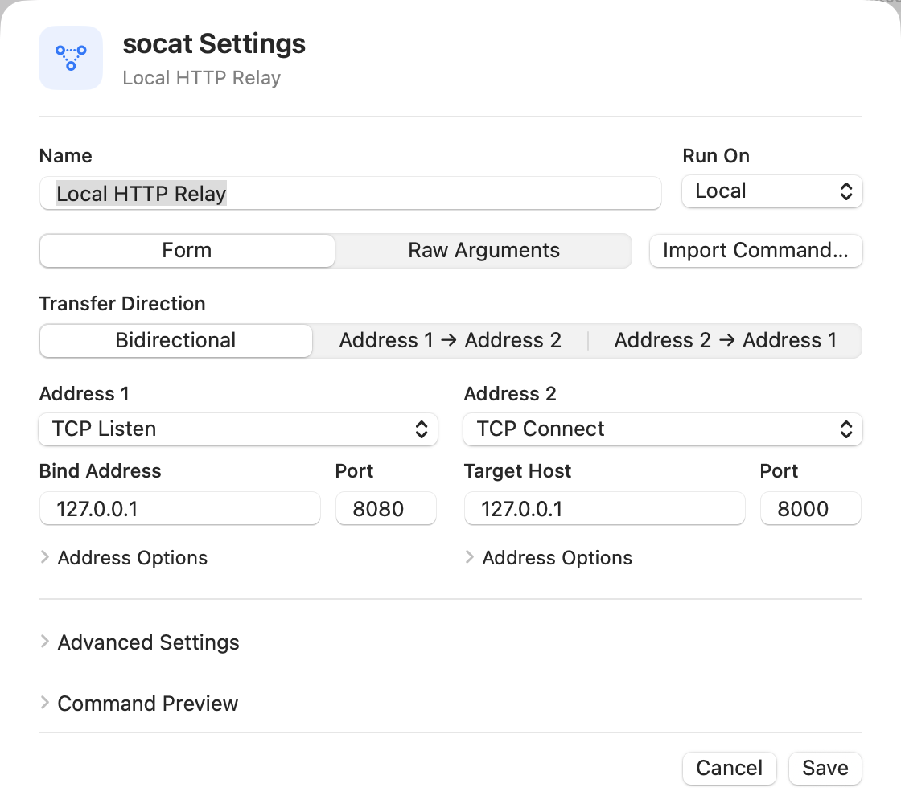
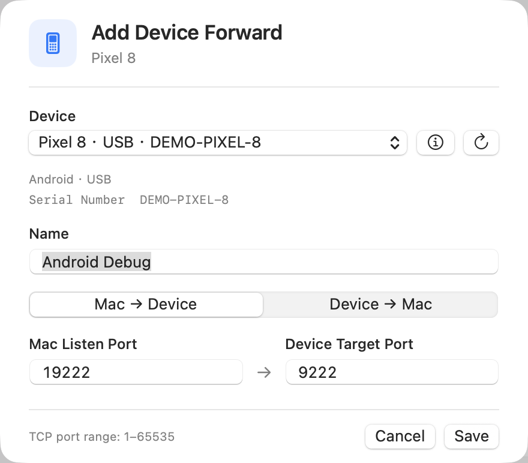

# Universal Tunnel Manager

English · [简体中文](README.zh-CN.md)

A macOS menu bar app for mobile-device forwarding, SSH tunnels, and socat sessions. The sidebar and menu bar share one profile list. Groups can contain any profile type and have a master switch. Use **New** to create a profile or group, or import a saved configuration.



| Platform | Direction | Backend |
| --- | --- | --- |
| Android | Mac → device | `adb forward` |
| Android | Device → Mac | `adb reverse` |
| iOS / iPadOS | Mac → device | `iproxy` over USB or paired Wi-Fi |
| SSH | Local, remote, and SOCKS forwarding | OpenSSH or a custom SSH client |
| socat | Local or remote execution over SSH | The selected machine’s `socat` binary |

## Build and run

Requires macOS 14 or later and Xcode 15 or later. Install only the tools needed for your workflows:

```sh
brew install --cask android-platform-tools
brew install libimobiledevice libusbmuxd
brew install socat
```

```sh
bash build-app.sh
open "dist/Universal Tunnel Manager.app"
```

For a universal build, pass `--arch arm64 --arch x86_64` to `build-app.sh`.

## SSH

SSH rules support multiple `-L`, `-R`, and `-D` mappings per connection, groups with a shared toggle, sorting and cloning, SSH config aliases (including `Include`), ProxyJump, identity file selection, reconnect and launch options, notifications, port-conflict checks, failure details, and copyable SOCKS setup commands. Advanced settings include keepalives, timeouts, compression, host-key policy, extra SSH arguments, a custom client, and an existing ControlMaster socket.

To copy profiles and groups from the standalone SSH Tunnel Manager, use **New → Import Configuration** and select its `~/Library/Application Support/SSHTunnelManager/tunnels.json`.

## socat

Create a profile and select **Local** or **Over SSH**. For SSH, choose the host from the same SSH config alias picker used by SSH tunnels, or enter `user@host`. Custom OpenSSH arguments and the socat executable path are under advanced options. The remote machine needs its own socat installation.

The default form lets you set the transfer direction, both addresses, and global and per-address options. To forward port 8080 to port 8000, choose **TCP Listen** for address 1 and **TCP Connect** for address 2. Enter the ports and leave both hosts at `127.0.0.1` to keep the listener on the selected machine's loopback interface. The form also offers UDP, Unix sockets, TLS, files, standard I/O, and custom addresses. You can preview the generated command and convert it to raw arguments for further editing.



In **Raw Arguments**, enter options and addresses without the executable name. Command-line mode handles quotes and escapes without shell expansion. **One argument per line** passes each line verbatim. Existing raw profiles open in this mode. **socat Help** queries `-hhh` on the selected machine.

Use **Import Command** in the form editor to paste a complete socat invocation, or **Convert to Form** to convert existing raw arguments. Supported address types populate the corresponding fields. Other addresses remain editable as custom addresses, and additional options retain their original order.

Enable **Run with sudo** in **Advanced Settings** for a profile that needs elevated privileges. A manual local start can prompt for your Mac account password. SSH runs, automatic starts, and retries use `sudo -n` and require sudo authorization without an interactive prompt. **Import Command…** accepts a leading `sudo` or `sudo -n` before `socat`.

Stdin supports typed lines, EOF, and a Mac input file. Stdout can append to a Mac file for binary transfers; logs show stderr and stdout when stdout is not redirected. With SSH and no input, the app asks the remote launcher to terminate socat when the channel closes. Jobs that detach themselves, or jobs using direct SSH I/O or a PTY, follow the remote system's session and signal handling. Privileged address types still require the permissions and drivers of the selected machine.

## Connection commands

Each profile has a **Connection Commands** section. Use **Before Connect**, **After Connect**, and **After Disconnect** to run commands on this Mac. SSH and socat profiles running over SSH also support all three on the SSH host. Each field accepts a multiline shell script. If both are set for a phase, the Mac command runs first.

Hooks use `/bin/sh` with a 30-second timeout per command. A failed before-connect command stops the attempt. On reconnect, the commands run again for the new attempt. After-disconnect commands run before a retry, including when an SSH or socat process exits with an error. A remote command opens its own SSH session using the profile’s connection settings. It needs a reachable host, even after the tunnel closes.

Existing SSH on-connect commands move to **Connection Commands → On This Mac → After Connect** when the app loads the configuration. Update any [OpenSSH tokens](https://man.openbsd.org/ssh_config.5#TOKENS) such as `%h` to work in `/bin/sh`.

## Configuration

Profiles and forwarding preferences live in `~/Library/Application Support/UniversalTunnelManager/tunnels.json`. Schema version 2 stores profiles in `rules`, with a `type` (`device`, `ssh`, or `socat`) and type-specific `settings`. The `groups` list stores group names and ordered profile references. Drag a profile between sidebar rows to set its position, or onto a group name to append it. Deleting a group returns its profiles to the ungrouped list.

Drag named group headers to reorder whole groups. The Ungrouped section uses a tray icon and appears at the top while it has profiles. Drag a profile there to remove it from a group. When that section is hidden or offscreen, a **Move to Ungrouped** target appears at the bottom of the sidebar during the drag. The same action is available in the profile’s contextual menu.

The app reads previous configuration formats and preserves existing SSH group membership. When migrating separate device, SSH, and socat files, it keeps the source files. **New → Import Configuration** skips existing profile IDs of the same type and imports new profiles with automatic startup disabled. The macOS login-item setting is managed by the system.

**New → Export Configuration** saves a JSON snapshot of all profiles, groups, and forwarding preferences. Importing that file through **Import Configuration** merges profiles and groups into the destination and keeps its existing app preferences. The export retains identity file paths. Private key files must be transferred separately.

Choose **Follow System**, **English**, or **简体中文** under **Preferences → Language** and reopen the app. Follow System uses the first supported language in your macOS language preferences and falls back to English.

The app's Bundle ID is `codes.var.tweak.utm`. Upgrading from the previous Bundle ID preserves profiles and forwarding preferences. macOS may prompt for notification permission again, and you may need to re-enable the new app's login item.

**Preferences** has shared controls for device forwarding, SSH tunnels, and socat sessions. **Restore previously enabled forwards on launch** re-enables the profiles left on in the last session. Per-profile SSH and socat auto-start options take effect independently. Connection sounds and macOS notifications can be enabled separately.

Turn on **Launch at login** and **Restore previously enabled forwards on launch** to restore forwarding at login. macOS may ask you to approve the login item under **System Settings → General → Login Items & Extensions**.
If macOS declines a change, the app opens that settings page and shows how to add, allow, or remove its login item there.

## Mobile devices

Enable debugging and authorize your Mac on Android. Connect wireless Android devices to the local ADB server first. For iOS over Wi-Fi, pair the device with your Mac and enable Wi-Fi syncing.

The app shows custom iOS device names when available. When the device reports a generic name such as “iPhone” or “iPad,” the app looks up its model using libirecovery if installed. If the model is unknown, it shows the model identifier and the last characters of the UDID.

Select a device, add a rule, and turn on its switch. An active status means ADB registered the forward or the proxy has started listening. The destination service still needs to be running.



Rules belong to a specific device. Disconnecting it moves its rules to **Offline configurations**, where you can still inspect them. For Android over Wi-Fi, the app uses the device serial rather than the network address. Rules saved by an older version using an ADB network address or emulator port remain available offline and must be recreated under the intended device.

For iOS over Wi-Fi, the app retains the device and any existing Mac listeners for up to 12 seconds after the last discovery. New forwards wait until the device is detected again.

## Port conflicts

Mac-to-device rules check the Mac listening port while you edit the rule and again when you enable it. The app keeps the rule and retries if the port is busy. With Android reverse forwarding, the Mac port is the destination and can already be in use by your local service.

To free a port, click **Show Listening Processes…** to see the process name, PID, and listening address. When you confirm **Force quit**, the app checks that the process still owns the listener and sends `SIGKILL`. You can only end processes owned by the current user. Force quitting can interrupt the process’s other connections and lose unsaved data.

The iOS proxy listens on `127.0.0.1`. Android uses the local ADB server and preserves existing mappings. The app removes forwarding rules it created during the session when you quit. If ADB still reports a conflict after the app was force quit, use `adb forward --list` or `adb -s SERIAL reverse --list` to inspect existing mappings.

## Acknowledgments

Thanks to 0fuz and the contributors to [SSH Tunnel Manager](https://github.com/0fuz/ssh-tunnel-manager). Universal Tunnel Manager’s SSH forwarding is based on [SSH Tunnel Manager v1.11.0](https://github.com/0fuz/ssh-tunnel-manager/releases/tag/v1.11.0). The upstream [MIT license](ThirdParty/SSHTunnelManager/LICENSE) is included in this repository.

## License

Universal Tunnel Manager is released under the [MIT License](LICENSE).
