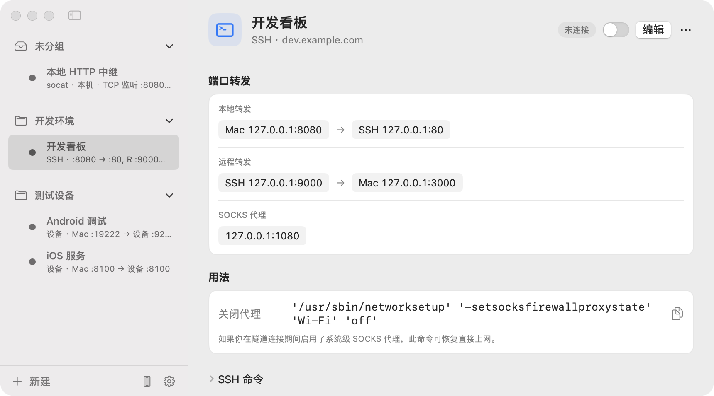
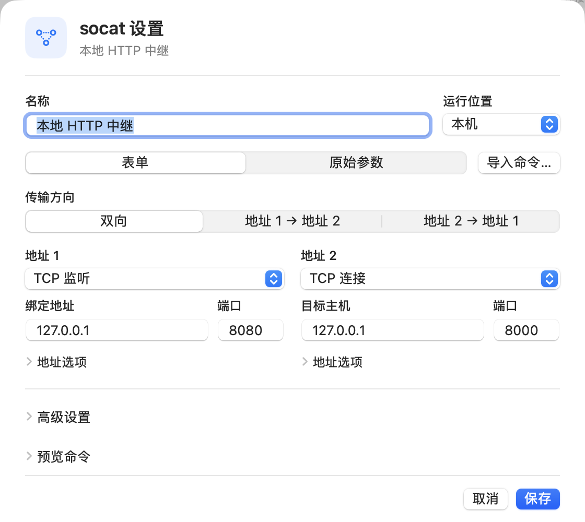
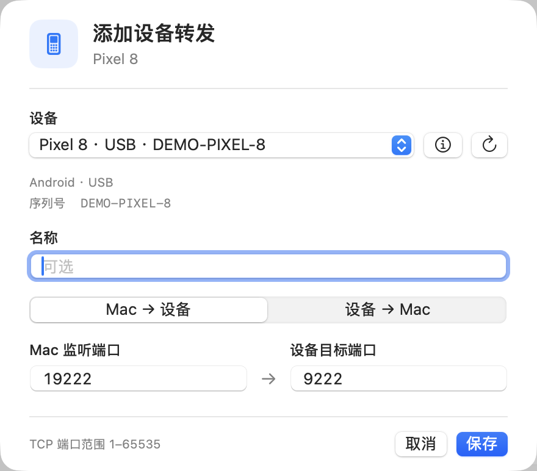

# Universal Tunnel Manager

[English](README.md) · 简体中文

在 macOS 上通过同一份 Profile 列表管理设备转发、SSH 隧道和 socat 会话。分组可以混放不同类型，并提供总开关。侧栏左下角的「新建」可以创建 Profile、创建分组或导入配置。



| 平台 | 方向 | 后端 |
| --- | --- | --- |
| Android | Mac → 设备 | `adb forward` |
| Android | 设备 → Mac | `adb reverse` |
| iOS / iPadOS | Mac → 设备 | `iproxy`（USB 或已配对的 Wi-Fi 设备） |
| SSH | 本地、远端和 SOCKS 转发 | OpenSSH 或自定义 SSH 客户端 |
| socat | 本机运行或通过 SSH 在远端运行 | 所选机器上的 `socat` |

## 构建与打开

需要 macOS 14 或更新版本及 Xcode 15 或更新版本。按需要安装对应工具：

```sh
brew install --cask android-platform-tools
brew install libimobiledevice libusbmuxd
brew install socat
```

```sh
bash build-app.sh
open "dist/Universal Tunnel Manager.app"
```

构建 Apple Silicon 和 Intel 通用版时，给 `build-app.sh` 传入 `--arch arm64 --arch x86_64`。

## SSH

SSH Profile 可混用多个 `-L`、`-R` 和 `-D` 映射。支持 SSH 配置别名与 `Include`、ProxyJump、私钥路径、启动时连接、断线重连、通知、端口冲突和失败提示，以及可复制的 SOCKS 系统代理命令。高级设置包括保活、超时、压缩、主机密钥选项、额外参数、自定义客户端和已有 ControlMaster 套接字。

通过「新建 → 导入配置」选择独立版的 `~/Library/Application Support/SSHTunnelManager/tunnels.json`，即可复制规则和分组。

## socat

新建配置，可选择「本机」或「通过 SSH」。通过 SSH 时，可以使用与 SSH 隧道相同的别名选择器，或直接填写 `user@host`。高级选项中可填写 OpenSSH 参数和 socat 可执行文件路径。远端需要安装 socat。

默认使用表单，可分别设置传输方向、两端地址、全局选项和地址选项。以 8080 转发到 8000 为例，地址 1 选择「TCP 监听」，地址 2 选择「TCP 连接」，填入端口，两端地址保留 `127.0.0.1`，即可只在所选机器的回环地址监听。表单也支持 UDP、Unix 套接字、TLS、文件、标准输入输出和自定义地址。可以预览生成的命令，也可以转为原始参数继续编辑。



「原始参数」模式直接填写选项和地址，省略可执行文件名。命令行模式支持引号和转义。「每行一个参数」逐行原样传递。已有的命令配置会在原始参数模式下打开。「socat 帮助」查询所选机器上的 `-hhh`。

在表单中点「导入命令…」可粘贴完整 socat 命令，在原始参数页点「转为表单」可转换已有配置。支持的地址类型会填入对应字段，其他地址放入自定义地址，附加选项保留原来的顺序。

需要管理员权限时，在 Profile 的「高级设置」中勾选「使用 sudo 运行」。手动在本机启动时可能需要输入 Mac 账户密码。SSH 远端运行、自动启动和重试使用 `sudo -n`，需要 sudo 能在无需交互提示的情况下授权。「导入命令…」可识别 `socat` 前面的 `sudo` 或 `sudo -n`。

标准输入可手动发一行、发送 EOF 或读取 Mac 上的文件。标准输出可追加到 Mac 上的文件以保留二进制数据，日志显示标准错误，以及未重定向的标准输出。SSH 无标准输入模式会在通道关闭时通知远端停止 socat。自行脱离会话的进程、直接使用 SSH 输入输出或 PTY 的进程，依赖远端系统的进程清理方式。需要额外权限或驱动的地址类型仍依赖运行环境。

## 连接命令

每条 Profile 都有「连接命令」设置，可以在本机执行「连接前」「连接后」「断开后」命令。SSH Profile 和「通过 SSH」运行的 socat Profile 也可在 SSH 主机上执行这三个阶段的命令。每个命令栏都支持多行脚本。同一阶段同时配置本机和远端时，先运行本机命令。

命令使用 `/bin/sh`，每条最多等待 30 秒。连接前命令失败会阻止本次连接。重新连接时会为新一轮连接再次执行钩子。SSH 或 socat 进程异常退出后，也会在重试前执行断开命令。远程命令使用该 Profile 的 SSH 设置建立单独会话，隧道关闭后仍需能够连接到主机。

应用加载配置时，会将旧 SSH 的连接后命令迁移到「连接命令 → 在本机执行 → 连接后」，并保存到新字段。若使用了 `%h` 等 [OpenSSH 占位符](https://man.openbsd.org/ssh_config.5#TOKENS)，需改成适用于 `/bin/sh` 的写法。

## 配置文件

Profile 和转发偏好统一保存在 `~/Library/Application Support/UniversalTunnelManager/tunnels.json`。配置版本 2 在 `rules` 中保存 Profile，通过 `type` 区分 `device`、`ssh` 或 `socat`，各自的参数保存在 `settings`。通用分组保存在 `groups`，记录组名和成员顺序。把 Profile 拖到侧栏两行之间可以指定插入位置，拖到分组名会放到组末尾。删除分组后，成员会回到未分组列表。

拖拽分组标题可调整整个分组的位置。「未分组」使用托盘图标，有成员时显示在顶部。把 Profile 拖到「未分组」即可移出原分组。如果该分组隐藏或滚出了可视范围，拖拽时侧栏底部会显示「移到未分组」放置区。也可以使用 Profile 的右键菜单。

新版兼容旧配置，保留原有 SSH 分组成员。迁移分开的旧配置文件时会保留源文件。「新建 → 导入配置」会跳过同类型、同 ID 的 Profile，导入的 Profile 默认关闭自动启动。登录项仍由 macOS 管理。

「新建 → 导出配置」将所有 Profile、分组和转发偏好保存到 JSON。通过「导入配置」回导时会合并 Profile 和分组，并保留目标应用现有的偏好设置。导出会保留私钥路径，私钥文件需另行迁移。

在「偏好设置 → 语言」中选择「跟随系统」、English 或简体中文，重新打开应用后生效。跟随系统按 macOS 的语言偏好使用首个受支持的语言，其他情况使用英文。

应用的 Bundle ID 为 `codes.var.tweak.utm`。从旧标识符升级时会继续读取已有的 Profile 和转发偏好。macOS 可能重新询问通知权限，登录项也可能需要重新开启。

「偏好设置」中的恢复转发、提示音和通知对设备转发、SSH 隧道和 socat 会话统一生效。「启动应用时恢复上次启用的转发」会重新启用上次使用时仍开启的 Profile。SSH 和 socat 的单条自动启动设置独立生效。提示音和 macOS 通知可分别开关。

需要随登录恢复转发时，开启「登录时自动启动」和「启动应用时恢复上次启用的转发」。macOS 可能要求在「系统设置 → 通用 → 登录项与扩展」中批准登录项。
如果 macOS 拒绝修改，应用会打开对应的系统设置页，并提示手动添加、允许或移除登录项。

## 移动设备

Android 请先打开调试并完成授权。无线 Android 设备需先连接到本机 ADB，iOS Wi-Fi 设备需先与 Mac 配对并启用 Wi-Fi 同步。

iOS 设备优先显示自定义名称。设备只返回「iPhone」或「iPad」时，应用会用已安装的 libirecovery 型号表查找具体型号，查不到时显示型号代码和 UDID 尾号。

选中设备，添加转发规则后打开开关。「已建立」表示转发已注册或代理已开始监听，目标端口仍需要实际运行服务。



转发规则按设备保存。设备断开后，规则会留在「离线配置」中供查看。Android 无线连接按设备序列号识别。旧版按 ADB 网络地址或模拟器端口保存的规则保留在离线配置中，请在确认身份的设备下重新添加。

iOS Wi-Fi 设备短暂从发现列表消失时，应用会从最后一次发现起保留设备和已启动的本机监听，最多 12 秒。新转发会等到重新发现设备再启动。

## 端口冲突

Mac → 设备的规则会在编辑时提示本机监听端口冲突，启用时再检查一次。遇到冲突会保留规则并重试。Android 设备 → Mac 的规则把 Mac 端口作为目标，允许本机服务已经在该端口监听。

若需释放冲突端口，点击「查看占用进程…」查看进程名、PID 和监听地址。确认「强制结束」后，应用会核对进程仍在监听该端口并发送 `SIGKILL`。仅可结束当前用户拥有的进程。进程的其他连接也会中断，未保存的数据可能丢失。

iOS 代理监听 `127.0.0.1`。Android 使用本机的 ADB 服务，启动规则时禁止覆盖已有映射。退出应用时会清理本次会话建立的转发。如果应用被强制退出后 ADB 仍报告端口冲突，可用 `adb forward --list` 或 `adb -s SERIAL reverse --list` 查看已有映射。

## 致谢

感谢 0fuz 和 [SSH Tunnel Manager](https://github.com/0fuz/ssh-tunnel-manager) 的贡献者。Universal Tunnel Manager 的 SSH 转发功能基于 [SSH Tunnel Manager v1.11.0](https://github.com/0fuz/ssh-tunnel-manager/releases/tag/v1.11.0)，仓库中附有上游的 [MIT 许可证](ThirdParty/SSHTunnelManager/LICENSE)。

## 许可证

Universal Tunnel Manager 采用 [MIT 许可证](LICENSE)。
